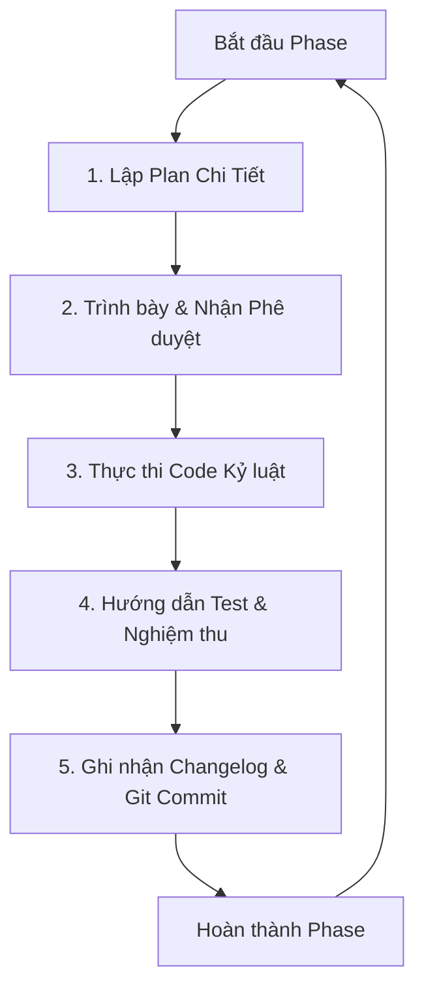

# Hướng Dẫn Sử Dụng Quy Trình Solo Builder 🛠️

Tài liệu này cung cấp hướng dẫn toàn diện về triết lý, cấu trúc thư mục, các quy tắc và cách thức vận hành dự án theo **Quy trình Solo Builder** tiêu chuẩn.

---

## 📑 Mục lục
1. [Giới thiệu về Solo Builder](#1-giới-thiệu-về-solo-builder)
2. [Cấu trúc Thư mục Tài liệu (Docs Structure)](#2-cấu-trúc-thư-mục-tài-liệu-docs-structure)
3. [Vòng đời của một Phase (Vòng lặp PDCA)](#3-vòng-đời-của-một-phase-vòng-lặp-pdca)
4. [Nguyên tắc Kỷ luật State Management](#4-nguyên-tắc-kỷ-luật-state-management)
5. [Cách Hướng dẫn AI Agent (Antigravity) Vận hành](#5-cách-hướng-dẫn-ai-agent-antigravity-vận-hành)
6. [Mẹo & Kinh nghiệm thực tế (Best Practices)](#6-mẹo--kinh-nghiệm-thực-tế-best-practices)

---

## 1. Giới thiệu về Solo Builder

**Solo Builder** là một quy trình làm việc phát triển phần mềm có kỷ luật, được tối ưu hóa đặc biệt cho mối quan hệ **Nhà phát triển (Con người) & AI Coding Agent (Máy)**. 

Thông thường, khi làm việc với AI Agent, dự án dễ bị rơi vào trạng thái:
- **Code Drift:** AI tự ý viết lại các đoạn logic chạy tốt trước đó mà không báo trước.
- **Context Bloat:** Dự án quá lớn khiến AI bị loãng thông tin (context window bị lấp đầy bởi các file không liên quan).
- **Thiếu tài liệu:** Không có CHANGELOG hoặc tài liệu yêu cầu rõ ràng, dẫn đến việc bàn giao khó khăn.

**Solo Builder giải quyết triệt để các vấn đề này bằng cách:**
1. Ràng buộc Agent hoạt động theo từng **Phase độc lập** (không nhảy phase).
2. Bắt buộc Agent thực hiện quy trình **Plan ➔ Review ➔ Execute ➔ Test ➔ Commit** cho từng đầu việc.
3. Đồng bộ hóa liên tục trạng thái code vào Git và Changelog.

---

## 2. Cấu trúc Thư mục Tài liệu (Docs Structure)

Mọi dự án áp dụng Solo Builder sẽ có một cấu trúc thư mục tài liệu đồng bộ tại thư mục gốc:

```text
├── AGENTS.md                  # "Hiến pháp" chứa luật chơi và Tech Stack của dự án
├── CHANGELOG.md               # Lịch sử ghi nhận các tính năng và bản sửa lỗi theo chuẩn Keep a Changelog
└── docs/
    ├── brief.md               # Tóm tắt nhanh ý tưởng, mục tiêu và phạm vi (In-Scope/Out-of-Scope)
    ├── BRD.md                 # Yêu cầu nghiệp vụ chi tiết (Business Requirements Document)
    └── plans/
        ├── master-plan.md     # Bản đồ lộ trình tổng thể chia theo từng Phase
        ├── phase-1.md         # Kế hoạch thực thi chi tiết của Phase 1 (Checklist, Expected Output, Test Guide)
        └── phase-2.md         # Kế hoạch thực thi chi tiết của Phase 2...
```

### Ý nghĩa của các file chính:
* **`AGENTS.md`**: Đây là file quan quan trọng nhất để thiết lập luật chơi. AI Agent khi bắt đầu làm việc sẽ luôn đọc file này đầu tiên để định hình vai trò (Senior Developer & PM), nắm vững quy trình làm việc và ghi nhớ chính xác Tech Stack được phép sử dụng.
* **`docs/plans/master-plan.md`**: Nơi quản lý lộ trình dài hạn của dự án. File này được định dạng dưới dạng danh sách markdown tickbox `[ ]`. Khi kết thúc một phase, box tương ứng sẽ được tick `[x]`.

---

## 3. Vòng đời của một Phase (Vòng lặp PDCA)

Khi phát triển một tính năng hoặc bắt đầu một Giai đoạn (Phase), quy trình làm việc được thực hiện khép kín qua 6 bước:



### Bước 1: Lập Kế hoạch Chi tiết (Plan Creation)
AI Agent hoặc Con người sẽ tạo một file kế hoạch cụ thể cho Phase đó (ví dụ: `docs/plans/phase-1.md`) dựa trên file mẫu `phase-template.md`. File này ghi rõ:
- **Task Checklist:** Từng đầu việc nhỏ cần code, kèm theo danh sách các file cụ thể sẽ tạo mới hoặc sửa đổi.
- **Expected Outcomes:** Kết quả đầu ra rõ ràng để xác định tính hoàn thành.
- **Testing Strategy:** Phương pháp test (Unit test, Integration test, hoặc manual steps).

### Bước 2: Duyệt Kế hoạch (Review & Approval)
Agent trình bày tóm tắt kế hoạch này cho bạn trong khung chat. Bạn xem xét, điều chỉnh nếu cần và gõ xác nhận phê duyệt (ví dụ: *"Ok, duyệt plan phase 1"*).

### Bước 3: Thực thi Kỷ luật (Execution)
Agent tiến hành viết code lần lượt theo checklist. 
* *Quy tắc:* Agent phải dùng các công cụ chỉnh sửa file chính xác (`replace_file_content` hoặc `multi_replace_file_content`), tránh đập đi viết lại toàn bộ các file lớn khi chỉ cần thay đổi vài dòng.

### Bước 4: Hướng dẫn Kiểm thử (Testing)
Sau khi hoàn thành code, Agent sẽ cung cấp hướng dẫn kiểm thử chi tiết từng bước (Manual Test Guide) để bạn có thể mở browser hoặc terminal kiểm tra, hoặc tự động viết test script.

### Bước 5: Cập nhật Trạng thái & Đóng gói (State Sync & Commit)
Khi mọi thứ hoạt động đúng kỳ vọng:
1. Agent cập nhật **`CHANGELOG.md`** để ghi nhận các cập nhật.
2. Agent đánh dấu tích `[x]` vào phase tương ứng trong **`docs/plans/master-plan.md`**.
3. Agent đề xuất hoặc thực hiện lệnh Git add, Git commit với thông điệp rõ ràng (ví dụ: `feat(phase-1): hoàn thành core logic và store`) và Git push để bảo vệ an toàn mã nguồn.

---

## 4. Nguyên tắc Kỷ luật State Management

Quản lý trạng thái dự án (State Management) là chìa khóa để duy trì sự mượt mà khi đổi ca làm việc hoặc chuyển giao. Hãy tuân thủ:

- **Nguyên tắc "Single Source of Truth":** Mọi yêu cầu nghiệp vụ đều phải nằm trong `BRD.md`, không thảo luận lan man bên ngoài rồi code chắp vá. Nếu nghiệp vụ thay đổi, hãy sửa `BRD.md` trước khi code.
- **Kỷ luật Changelog:** Không commit code mà không cập nhật `CHANGELOG.md`. Điều này giúp bạn luôn biết phiên bản hiện tại có những gì mới mà không cần đọc lịch sử git rối rắm.
- **Không Nhảy Phase:** Dù tính năng của Phase 3 có hấp dẫn đến đâu, tuyệt đối không được viết code cho Phase 3 khi Phase 1 và Phase 2 chưa hoàn thành `[x]`. Điều này giữ cho context của Agent luôn tập trung và hạn chế bug phát sinh chéo.

---

## 5. Cách Hướng dẫn AI Agent (Antigravity) Vận hành

Khi bạn làm việc với một AI Agent hỗ trợ Solo Builder (như Antigravity), bạn có thể dùng các câu lệnh/prompt mẫu sau để kích hoạt đúng kỹ năng của Agent:

* **Khi khởi động dự án mới:**
  > *"Hãy đọc AGENTS.md và thiết lập kế hoạch Master Plan cho dự án mới này."*

* **Khi bắt đầu một Phase mới:**
  > *"Chúng ta chuẩn bị bắt đầu Phase 2. Hãy lập kế hoạch chi tiết cho Phase 2 trong thư mục docs/plans/ theo đúng chuẩn quy trình Solo Builder."*

* **Khi muốn nghiệm thu:**
  > *"Tôi đã test xong và mọi thứ chạy tốt. Hãy tiến hành đóng gói Phase 1, cập nhật CHANGELOG và đề xuất commit Git giúp tôi."*

---

## 6. Mẹo & Kinh nghiệm thực tế (Best Practices)

1. **Giữ các file Phase ngắn gọn:** Đừng gom quá nhiều đầu việc vào một phase. Hãy chia nhỏ dự án thành 4-6 phase. Mỗi phase chỉ nên thực hiện trong khoảng 1-3 ngày làm việc.
2. **Sử dụng Mermaid Diagram:** Thêm sơ đồ Mermaid vào `BRD.md` để mô tả luồng dữ liệu. Agent đọc hiểu sơ đồ Mermaid cực kỳ tốt và sẽ code chính xác theo cấu trúc sơ đồ vẽ ra.
3. **Chạy setup.cjs ngay khi chuyển giao:** Khi đưa source code sang máy tính khác hoặc folder khác, hãy chạy `node solo-builder-kit/setup.cjs` để thiết lập/đồng bộ lại cấu trúc rules cho IDE phát hiện tức thì.
