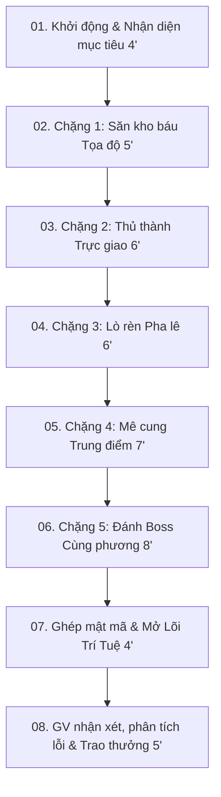

# Business Requirements Document (BRD)
## Hệ Thống Dạy Học Tương Tác Mathverse Oxyz & Báo Cáo Biện Pháp GVG

---

## 1. Yêu Cầu Chức Năng (Functional Requirements)

### 1.1. Module Sư Phạm & Game Engine (Mathverse Oxyz)
- **FR-1 (Hành trình 5 chặng):**
  - Chặng 1: Săn kho báu tọa độ $\vec{AB} = (x_B-x_A; y_B-y_A; z_B-z_A)$. Mảnh mật mã: `3`.
  - Chặng 2: Thủ thành trực giao $\vec{u} \cdot \vec{v} = x_1x_2 + y_1y_2 + z_1z_2 = 0$. Mảnh mật mã: `0`.
  - Chặng 3: Lò rèn pha lê khoảng cách $AB = \sqrt{\Delta x^2 + \Delta y^2 + \Delta z^2}$. Mảnh mật mã: `5`.
  - Chặng 4: Mê cung trung điểm $I = \left(\frac{x_A+x_B}{2}; \frac{y_A+y_B}{2}; \frac{z_A+z_B}{2}\right)$. Mảnh mật mã: `2`.
  - Chặng 5: Đại chiến Boss cùng phương $\vec{u} = k\vec{v}$. Mảnh mật mã: `4`.
- **FR-2 (Cơ chế Gamification):**
  - Mỗi chặng 3 lượt chơi nhỏ (tổng cộng 15 lượt).
  - Hệ thống khiên (bắt đầu 3 khiên). Trả lời sai trừ 1 khiên, cạn khiên không bị loại, cho phép thử lại với gợi ý sư phạm.
  - Điểm chặng: 20 XP (đúng 3 lượt ngay, không gợi ý), 12 XP (sai 1-2 lần hoặc dùng gợi ý), 8 XP (sai từ 3 lần).
  - Trạm cuối: Nhập đúng mật mã `30524` và giải nghĩa thông điệp *"TƯ DUY VÀ HỢP TÁC MỞ KHO BÁU"* được cộng 20 XP.
  - Giáo viên có quyền cộng điểm hợp tác (0–10 XP). Tổng điểm tối đa: 130 XP.

### 1.2. Module Quản Lý Giáo Viên (Teacher Dashboard)
- **FR-3 (Điều khiển phòng học):**
  - Tạo phòng 4–8 đội, sinh mã PIN đăng nhập riêng cho từng đội.
  - Theo dõi realtime tiến độ từng đội (chặng hiện tại, lượt 1/3-3/3, số khiên còn lại, XP, nhật ký hành động).
  - Nút **Tạm dừng** / **Tiếp tục** để giáo viên ngắt kết nối nộp bài khi cần chốt kiến thức hoặc giải thích lỗi sai chung.
  - Đồng hồ đếm ngược tiết học (mặc định 45 phút, có các mốc 35, 40, 45, 50 phút).
  - Nút **Công bố giải thưởng** và **Xuất dữ liệu CSV** (gồm tên đội, số chặng, số lần sai, khiên, điểm XP, điểm hợp tác, thời gian hoàn thành) làm minh chứng đánh giá.

### 1.3. Module Báo Cáo Biện Pháp (Hồ sơ dự thi GVG)
- **FR-4 (Nội dung văn bản theo mẫu):**
  - Độ dài chuẩn: Tối đa **3 trang** file Word.
  - Cơ cấu gồm:
    1. *Tên biện pháp:* Ôn tập kiến thức bằng game tương tác.
    2. *Nội dung cách thức thực hiện biện pháp:* Mô tả rõ cách thiết kế 5 chặng, quy trình tổ chức tiết dạy 45 phút, phân vai hợp tác nhóm.
    3. *Hiệu quả mang lại:* Tăng hứng thú, xóa bỏ áp lực công thức khô khan, phát triển năng lực tự học và giao tiếp toán học.
    4. *Minh chứng về sự tiến bộ của học sinh:* Bảng số liệu khảo sát đối chứng trước và sau khi áp dụng (tỉ lệ hứng thú, điểm kiểm tra định kỳ/đánh giá quá trình, mức độ thuần thục công thức).

---

## 2. Yêu Cầu Phi Chức Năng (Non-Functional Requirements)

- **Độc lập mạng (Offline / LAN First):** Không yêu cầu Internet ngoài. Máy chủ phát hoặc chạy trên cùng mạng Wi-Fi cục bộ trường học.
- **Tương thích cao:** Hoạt động trơn tru trên mọi trình duyệt hiện đại (Chrome, Safari, Edge, Cốc Cốc) của điện thoại Android, iPhone, iPad, laptop.
- **Zero-Dependency:** Máy chủ Node.js không cần cài thêm gói thư viện ngoài (npm install) để tránh lỗi mạng khi demo.
- **Tính khả thi & Chống gian lận:** Mỗi đội chỉ có 1 tài khoản/mã PIN; giao diện một người bấm đại diện tránh xung đột dữ liệu gửi lên.

---

## 3. Quy Trình Vận Hành Tiết Dạy (Pedagogical Workflow)

