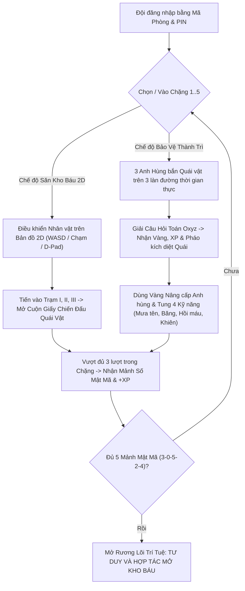

# Business Requirements Document (BRD)
## Hệ Thống Dạy Học Tương Tác Mathverse Oxyz & Báo Cáo Biện Pháp GVG

---

## 1. Yêu Cầu Chức Năng (Functional Requirements)

### 1.1. Module Sư Phạm & 2 Game Engine Tương Tác Nhóm (Mathverse Oxyz)
Hệ thống tích hợp **2 cơ chế game tương tác thực thụ** lấy cảm hứng từ *Săn Kho Báu (`hunt-preview`)* và *Bảo Vệ Thành Trì (`castle-defense`)*, cho phép học sinh tham gia theo nhóm (4–8 đội) qua 5 chặng kiến thức Toán 12 (Vectơ & Hệ trục tọa độ Oxyz – CT GDPT 2018):

- **FR-1 (Engine 1 – Săn Kho Báu 2D Map / Scavenger Hunt):**
  - Bản đồ thế giới 2D Top-Down (`48x36` ô địa hình: rừng cây, vách đá pha lê, tường mê cung, sông suối, cầu gỗ) có hiệu ứng sương mù/tầm nhìn và camera tự động di chuyển theo nhân vật của Đội.
  - Hỗ trợ điều khiển đa phương thức: Phím **WASD / Mũi tên**, **Click/Chạm trực tiếp trên bản đồ** để nhân vật tự di chuyển tới vị trí chạm, và **Cụm phím D-Pad ảo** trên màn hình điện thoại/máy tính bảng.
  - Trên bản đồ bố trí **3 Trạm Quái Vật / Rương Tọa Độ (I, II, III)** có vòng hào quang phát sáng (`hw-ring`) và **Rương Kho Báu Chặng**.
  - Khi nhân vật đi vào vùng trạm, **Cửa sổ Chiến Đấu Cuộn Giấy Cổ (Battle Scroll Modal)** bật lên: hiển thị Quái vật canh trạm, vai trò hợp tác của từng thành viên nhóm, câu hỏi Toán Oxyz (hỗ trợ **Trắc nghiệm ABCD**, **Đúng/Sai**, **Trả lời ngắn**), nút **"🏃 Rút lui"** và **"⚔️ Tấn công"**.
  - Trả lời đúng sẽ kích hoạt hiệu ứng nổ `💥` tiêu diệt quái vật, hiệu ứng **Mảnh mật mã bay vào túi khóa (`hw-letter-fly`)** trên thanh HUD.

- **FR-2 (Engine 2 – Bảo Vệ Thành Trì Thời Gian Thực / Castle Defense):**
  - Chiến trường thời gian thực (`requestAnimationFrame`) với **Thành Trì Oxyz** (có thanh máu `Castle HP`, lá chắn `Castle Shield`) và **3 Anh Hùng** (`🏹 Cung Thủ Trục X`, `🧙‍♂️ Pháp Sư Trục Y`, `🛡️ Hiệp Sĩ Trục Z`) trấn giữ 3 làn đường (`lane 0, 1, 2`).
  - Các đợt **Quái vật (`Goblin`, `Dơi Toán Học`, `Bộ Xương`, `Orc Thiết Giáp`, `Boss Bóng Đen`)** liên tục xuất hiện và di chuyển từ phải sang trái theo 3 làn đường. Anh hùng tự động bắn đạn/phép thuật (`projectiles`), hiển thị sát thương nổi (`-35`) và hiệu ứng trúng đòn.
  - **Bảng Câu Hỏi Toán Học (Question Panel)** gắn liền phía dưới chiến trường: Nhóm học sinh thảo luận giải bài toán Oxyz để nhận **Vàng (+Gold)**, **Kinh nghiệm (+XP / Level Up)**, đồng thời kích hoạt **Đòn Pháo Kích Tọa Độ** tiêu diệt đợt quái vật tương ứng.
  - **Bảng Nâng Cấp (Upgrade Panel) & Thanh Kỹ Năng (Skill Dock):**
    - Dùng Vàng nâng cấp 4 chỉ số đội hình: **Sát thương (Damage)**, **Tốc độ bắn (Attack Speed)**, **Máu Anh Hùng (Hero HP)**, **Hồi phục Thành (Regeneration)**.
    - 4 Kỹ năng chủ động có thời gian hồi chiêu (Cooldown): **🌧️ Mưa Tên Vectơ (Arrow Rain)**, **❄️ Băng Giá Trực Giao (Ice Volley - làm chậm quái)**, **💚 Hồi Máu Đồng Đội (Group Heal)**, **🛡️ Khiên Thành Trì (Castle Shield)**.

- **FR-3 (Hành trình 5 chặng Oxyz & Chuyển đổi linh hoạt):**
  - **Chặng 1:** *Săn Kho Báu Tọa Độ* (Rừng Vectơ – Tọa độ $\vec{AB}$) – Mặc định: **Săn Kho Báu 2D Map**. Mảnh mật mã: `3`.
  - **Chặng 2:** *Thủ Thành Trực Giao* (Pháo Đài Vuông Góc – Tích vô hướng $\vec{u}\cdot\vec{v}$) – Mặc định: **Bảo Vệ Thành Trì**. Mảnh mật mã: `0`.
  - **Chặng 3:** *Thung Lũng Pha Lê Khoảng Cách* (Tháp Pha Lê – Độ dài đoạn thẳng $AB$) – Mặc định: **Săn Kho Báu 2D Map**. Mảnh mật mã: `5`.
  - **Chặng 4:** *Mê Cung Trung Điểm* (Mê Cung Không Gian – Tọa độ trung điểm $I$) – Mặc định: **Săn Kho Báu 2D Map**. Mảnh mật mã: `2`.
  - **Chặng 5:** *Đại Chiến Boss Bóng Đen* (Thành Trì Cuối – Hai vectơ cùng phương $\vec{u}=k\vec{v}$) – Mặc định: **Bảo Vệ Thành Trì**. Mảnh mật mã: `4`.
  - **Chuyển đổi chế độ chơi (Mode Switcher):** Học sinh/Giáo viên có thể chuyển đổi qua lại giữa 2 chế độ **🗺️ Săn Kho Báu 2D** và **🏰 Bảo Vệ Thành Trì** ngay trong bất kỳ chặng nào.
  - **Trạm cuối:** Ghép 5 chữ số mật mã `30524` và giải thông điệp *"TƯ DUY VÀ HỢP TÁC MỞ KHO BÁU"* (+20 XP).

### 1.2. Module Quản Lý Giáo Viên (Teacher Dashboard)
- **FR-4 (Điều khiển phòng học thời gian thực):**
  - Tạo phòng 4–8 đội, cấp mã PIN riêng cho từng đội hoặc sao chép link đăng nhập nhanh.
  - Bản đồ trực quan giám sát tiến độ từng đội (chặng hiện tại, lượt 1/3–3/3, số khiên/máu thành trì, lượng vàng, điểm XP, nhật ký sự kiện).
  - Nút **Tạm dừng / Tiếp tục**, đồng hồ đếm ngược tiết học (35/40/45/50 phút), cộng điểm hợp tác (0–10 XP), **Công bố giải thưởng** và **Xuất file CSV**.

### 1.3. Module Báo Cáo Biện Pháp (Hồ sơ dự thi GVG)
- **FR-5 (Nội dung văn bản theo mẫu):**
  - Tối đa **3 trang** file Word (`Bien phap gop phan nang cao chat luong DH.docx`), làm rõ cách ứng dụng 2 mô hình game tương tác nhóm (*Săn Kho Báu 2D* & *Bảo Vệ Thành Trì*) vào ôn tập chương Oxyz Toán 12 và bảng số liệu minh chứng thực nghiệm.

---

## 2. Yêu Cầu Phi Chức Năng (Non-Functional Requirements)

- **Độc lập mạng (Offline / LAN First):** Chạy hoàn toàn trên mạng LAN/Wi-Fi nội bộ lớp học hoặc file đơn `CHOI_THU_1_MAY.html`, không phụ thuộc Internet hay tài nguyên CDN bên ngoài.
- **Tương thích cao (Responsive):** Chạy mượt 60fps trên cả máy chiếu giáo viên, laptop và điện thoại di động của học sinh.
- **Zero-Dependency:** Node.js thuần (`http`, `fs`, `path`, `crypto`, `os`), không cần `npm install`.

---

## 3. Luồng Nghiệp Vụ Tương Tác Nhóm (Group Gameplay Workflow)

